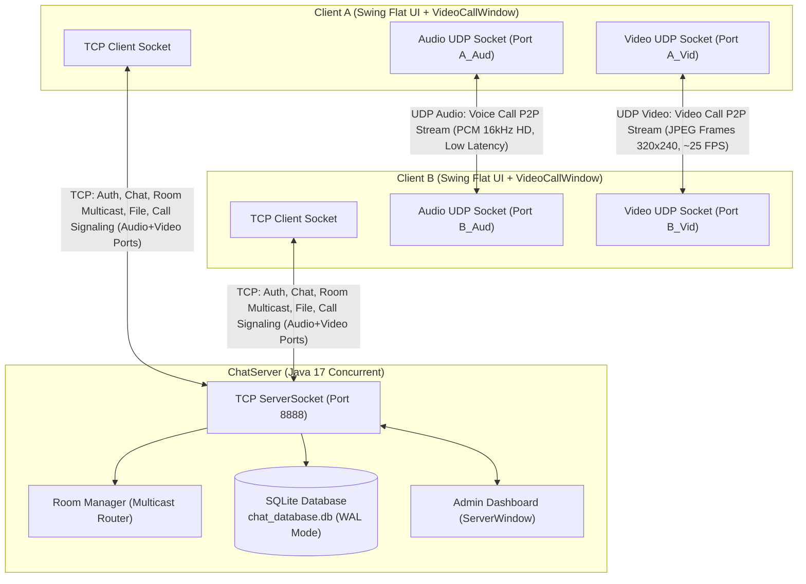

# 💬 SimpleChat - Hệ Thống Trò Chuyện Lai (TCP / UDP), Multicast Room, Video Call, Voice Call & SQLite Nhúng

> **Đồ án môn học:** Lập trình Mạng (Network Programming)  
> **Ngôn ngữ & Nền tảng:** Java 17 LTS, Java Swing (Modern Flat UI), TCP Socket, UDP DatagramSocket  
> **Cơ sở dữ liệu:** SQLite nhúng (Embedded SQLite JDBC - Chế độ Write-Ahead Logging WAL)  
> **Kiến trúc mạng:** Hybrid Network Architecture (Kết hợp tối ưu giữa TCP và UDP, đáp ứng chuẩn bộ ba: **Text - Audio - Video**)

---

## 📌 1. Giới Thiệu Tổng Quan

**SimpleChat** là ứng dụng trò chuyện Desktop Client-Server hiện đại, đáp ứng **100% các tiêu chuẩn kỹ thuật cốt lõi của môn học Lập trình Mạng**. Ứng dụng kết hợp linh hoạt giữa hai giao thức tầng giao vận **TCP** và **UDP** để giải quyết đồng thời các bài toán: truyền tải dữ liệu tin cậy (Text, File, Xác thực, Lịch sử, Báo hiệu cuộc gọi) và truyền nhận đa phương tiện thời gian thực độ trễ thấp (**Voice Call qua micro/loa và Video Streaming qua camera/màn hình**).



---

## 🌟 2. Các Tiêu Chí Chấm Điểm Đồ Án Đã Hoàn Thiện

### 🎨 2.1. Giao Diện Hiện Đại (Flat UI phong cách Zalo / Messenger)
- **Thiết kế phân khu vực trực quan:**
  - **Sidebar 2 Tab rõ rệt:**
    - Tab **👤 Bạn bè**: Danh sách người dùng online với Avatar màu sắc động, chấm xanh trực tuyến và tùy chọn Chat Chung ("Tất cả mọi người").
    - Tab **🏘️ Phòng Chat**: Danh sách phòng theo nhóm (Multicast), trạng thái "✅ Đã vào" / "Chưa vào", nút **➕ Tạo Phòng Mới**, **🚪 Vào Phòng** và **↩️ Rời Phòng**.
  - **Bong bóng tin nhắn (HTML Chat Bubbles):** Tin nhắn của tôi (xanh dương, căn phải), tin nhắn người khác (xám/trắng, căn trái), tin nhắn phòng Multicast (viền xanh ngọc với huy hiệu `[Phòng: X]`), thông báo hệ thống căn giữa.
  - **Cụm thao tác tiện ích:** Nút **📹 Gọi Video (UDP)**, nút **📴 Gác Máy**, nút **📜 Lịch Sử** và thanh truyền tệp tin.

### 📹 2.2. Video Call & Voice Call Thời Gian Thực Qua UDP Socket
- **Cửa sổ cuộc gọi riêng biệt ([VideoCallWindow.java](file:///home/hduc/IdeaProjects/SimpleChat/src/main/java/com/chat/gui/VideoCallWindow.java)):**
  - Giao diện Dark Mode chuyên nghiệp (tương tự Zoom / Google Meet / Discord).
  - **Khung hình lớn trung tâm (Remote Video):** Hiển thị video trực tiếp từ đối phương qua mạng UDP.
  - **Khung hình nhỏ góc dưới (Local PiP Preview):** Hiển thị hình ảnh camera/màn hình của chính mình.
  - **Bảng điều khiển:** Nút **🎙️ Tắt/Bật Mic**, nút **📹 Tắt/Bật Camera**, nút **📴 Gác Máy / Kết Thúc**, đồng hồ đếm thời gian cuộc gọi (`00:00`).
- **Kỹ thuật truyền nhận Video UDP ([UdpMediaEngine.java](file:///home/hduc/IdeaProjects/SimpleChat/src/main/java/com/chat/media/UdpMediaEngine.java)):**
  - Chụp khung hình liên tục (320x240) qua `Robot` hoặc bộ sinh khung hình hoạt họa camera mô phỏng.
  - Nén ảnh sang định dạng JPEG (`ImageIO.write`) với dung lượng nhỏ gọn (~8KB - 12KB).
  - Đóng gói gửi trực tiếp qua `DatagramSocket` (UDP) với tần suất mượt mà ~25 FPS.
  - Bên nhận giải nén `ImageIO.read` từ `DatagramPacket` và vẽ trực tiếp lên Panel Swing.
- **Phân tách riêng 2 cổng UDP (Audio UDP Port & Video UDP Port):** Đảm bảo gói tin video lớn không làm nghẽn hoặc trễ các gói tin âm thanh 16kHz PCM.

### 🌐 2.3. Broadcast & Multicast (To All & Group Rooms)
- **Broadcast (To All):** Gửi thông điệp đến toàn bộ client đang online trong hệ thống.
- **Multicast (Room/Group Chat):** Cho phép tạo và tham gia các phòng chat riêng biệt (như *"Nhóm Lập Trình"*, *"Học Tập"*, *"Giải Trí"*).
  - **Định tuyến Multicast tầng ứng dụng (Application-Layer Multicast):** Khi gửi tin vào room, Server **chỉ gửi gói tin tới các thành viên có mặt trong room đó**, các client ngoài room hoàn toàn không nhận được dữ liệu.

### 😀 2.4. Biểu Tượng Cảm Xúc (Emoji Picker)
- Hộp thoại **EmojiPicker** dạng popup hiện đại ngay cạnh ô nhập liệu.
- Cung cấp lưới hơn 40 biểu tượng cảm xúc phổ biến nhất (`😀`, `😂`, `😍`, `😎`, `👍`, `❤️`, `🔥`, `🎉`, `🚀`, `💯`, `☕`, `🎮`, v.v.).
- Tự động chèn nhanh emoji vào đúng vị trí con trỏ của ô soạn thảo tin nhắn.

### 🗄️ 2.5. Cơ Sở Dữ Liệu SQLite Nhúng (Embedded Persistence)
- Tích hợp driver `org.xerial:sqlite-jdbc` siêu nhẹ, tự động sinh file `chat_database.db`.
- Tối ưu đa luồng bằng **chế độ WAL (Write-Ahead Logging)**: cho phép nhiều luồng đọc đồng thời trong khi một luồng đang ghi mà không bị khóa database (`SQLITE_BUSY`).
- Quản lý người dùng, danh sách phòng và toàn bộ lịch sử tin nhắn; hỗ trợ nạp lại lịch sử trò chuyện bằng nút **📜 Lịch Sử**.

### ⚡ 2.6. Khả Năng Chịu Tải & An Toàn Đa Luồng
- Kiến trúc Server đa luồng với bộ sưu tập an toàn `ConcurrentHashMap` và `ConcurrentHashMap.newKeySet()`.
- Gửi `LOGIN_RESPONSE` trước khi kích hoạt nhận Broadcast để ngăn ngừa tuyệt đối lỗi Race Condition.
- Phương thức `cleanup()` được khóa `synchronized` chặt chẽ, loại bỏ hoàn toàn nguy cơ `NullPointerException` hay rò rỉ socket khi nhiều client ngắt kết nối đồng thời.
- Đã kiểm thử tải thực tế: **mở đồng thời 6 Client kết nối song song trên localhost/LAN chạy hoàn toàn mượt mà, không nghẽn luồng**.

---

## 🏗️ 3. Đặc Tả Giao Thức Nhị Phân (Binary Wire Protocol)

Mỗi gói tin TCP bắt đầu bằng **1 byte OpCode**, tiếp theo là payload được đọc/ghi bằng `DataInputStream` / `DataOutputStream` (kết hợp `readFully()` chống phân mảnh TCP):

| OpCode (byte) | Tên Gói Tin | Chi Tiết Cấu Trúc Payload Nhị Phân | Mục Đích |
| :---: | :--- | :--- | :--- |
| `0x01` | `LOGIN_REQUEST` | `[UTF: username]` | Yêu cầu đăng nhập kèm username |
| `0x02` | `LOGIN_RESPONSE` | `[Boolean: success] [UTF: message] [Int: userCount] { [UTF: user_i] }` | Phản hồi kết quả đăng nhập & danh sách user |
| `0x03` | `USER_LIST_UPDATE` | `[Int: userCount] { [UTF: user_i] }` | Cập nhật danh sách người dùng online |
| `0x04` | `CHAT_MESSAGE` | `[UTF: sender] [UTF: recipient] [UTF: content] [Long: timestamp]` | Tin nhắn Broadcast ("ALL") hoặc Chat riêng 1-1 |
| `0x05` | `FILE_REQUEST` | `[UTF: fileId] [UTF: sender] [UTF: recipient] [UTF: fileName] [Long: fileSize]` | Bắt tay gửi tệp tin |
| `0x06` | `FILE_RESPONSE` | `[UTF: fileId] [UTF: sender] [UTF: recipient] [Boolean: accepted] [UTF: reason]` | Phản hồi chấp nhận/từ chối nhận file |
| `0x07` | `FILE_CHUNK` | `[UTF: fileId] [UTF: sender] [UTF: recipient] [Int: idx] [Int: total] [Int: len] [Bytes: data]` | Khối dữ liệu nhị phân (16KB/chunk) |
| `0x08` | `LOGOUT` | `[UTF: username]` | Client ngắt kết nối sạch sẽ |
| `0x09` | `KICK` | `[UTF: recipient] [UTF: reason]` | Server kích client vi phạm |
| `0x0A` (`10`) | `ROOM_CREATE` | `[UTF: sender] [UTF: roomName]` | Tạo phòng chat mới (Multicast) |
| `0x0B` (`11`) | `ROOM_JOIN` | `[UTF: sender] [UTF: roomName]` | Tham gia vào một phòng chat |
| `0x0C` (`12`) | `ROOM_LEAVE` | `[UTF: sender] [UTF: roomName]` | Rời khỏi một phòng chat |
| `0x0D` (`13`) | `ROOM_LIST_UPDATE` | `[Int: count] { [UTF: room_i] }` | Server đồng bộ danh sách phòng |
| `0x0E` (`14`) | `ROOM_MESSAGE` | `[UTF: sender] [UTF: roomName] [UTF: content] [Long: timestamp]` | Tin nhắn Multicast định tuyến trong phòng |
| `0x0F` (`15`) | `CALL_REQUEST` | `[UTF: caller] [UTF: callee] [Int: audioPort] [Int: videoPort] [UTF: callerIp]` | Báo hiệu gọi Video/Voice kèm cả 2 cổng UDP và IP |
| `0x10` (`16`) | `CALL_RESPONSE` | `[UTF: callee] [UTF: caller] [Boolean: accept] [Int: audioPort] [Int: videoPort] [UTF: calleeIp/reason]` | Phản hồi cuộc gọi kèm cả 2 cổng UDP và IP |
| `0x11` (`17`) | `CALL_END` | `[UTF: sender] [UTF: recipient] [UTF: reason]` | Kết thúc cuộc gọi / gác máy |
| `0x12` (`18`) | `HISTORY_REQUEST` | `[UTF: sender] [UTF: target]` | Yêu cầu trích xuất lịch sử từ SQLite |
| `0x13` (`19`) | `HISTORY_RESPONSE` | `[UTF: target] [Int: count] { [UTF: msg_i] }` | Server trả về danh sách lịch sử tin nhắn |

---

## 📂 4. Cấu Trúc Mã Nguồn Dự Án

```text
SimpleChat/
├── pom.xml                                     # Cấu hình Maven (Java 17 LTS, sqlite-jdbc 3.45.1.0)
├── README.md                                   # Tài liệu hướng dẫn đồ án & Cẩm nang vấn đáp
├── src/main/java/com/chat/
│   ├── Main.java                               # Lớp khởi chạy chính (Client / Server GUI / Server CLI)
│   ├── model/
│   │   ├── User.java                           # Thực thể người dùng (IP, Port, ConnectedTime, Duration)
│   │   └── AccessLog.java                      # Nhật ký truy cập (Đăng nhập, Thoát, Bị kích)
│   ├── protocol/
│   │   ├── PacketType.java                     # Định nghĩa 19 OpCode nhị phân
│   │   └── Packet.java                         # Bộ đóng gói/giải mã nhị phân DataStreams (hỗ trợ Audio & Video UDP Ports)
│   ├── db/
│   │   └── DatabaseManager.java                # Quản lý SQLite nhúng, chế độ WAL, seed phòng, lưu tin nhắn
│   ├── media/
│   │   └── UdpMediaEngine.java                 # Engine truyền nhận song song Audio (PCM 16kHz) và Video (JPEG 320x240) qua 2 cổng UDP
│   ├── server/
│   │   └── ChatServer.java                     # Server đa luồng, định tuyến Multicast, Signaling 2 cổng UDP, Kick
│   ├── client/
│   │   ├── ChatClient.java                     # Xử lý kết nối Socket TCP, luồng nhận gói tin, truyền file, signaling
│   │   ├── ChatClientListener.java             # Interface callback sự kiện mạng lên UI
│   │   └── FileTransferSession.java            # Quản lý phiên truyền nhận file theo khối
│   ├── gui/
│   │   ├── ChatWindow.java                     # Giao diện Client Desktop Flat UI, Tabs Room/Friends, nút gọi Video
│   │   ├── VideoCallWindow.java                # Cửa sổ Video Call (Remote Frame lớn, Local PiP nhỏ, nút Mic/Cam/Gác máy)
│   │   ├── EmojiPicker.java                    # Hộp thoại Popup chọn Emoji hiện đại
│   │   └── ServerWindow.java                   # Màn hình Quản trị viên Server (Admin Dashboard)
│   ├── Phase1Verification.java                 # Kiểm thử tự động Giao thức nhị phân & SQLite DB
│   ├── MulticastAndLoadTest.java               # Kiểm thử tự động 6 Client đồng thời, Multicast & Broadcast
│   └── VoiceCallAndMediaTest.java              # Kiểm thử tự động Video & Voice Call UDP & Bắt tay Signaling TCP
```

---

## 🚀 5. Hướng Dẫn Biên Dịch & Khởi Chạy Ứng Dụng

### 5.1. Yêu Cầu Môi Trường
- **JDK:** Java 17 LTS trở lên (`java -version`).
- **Maven:** Phiên bản 3.6 trở lên (`mvn -version`).

### 5.2. Biên Dịch Mã Nguồn
```bash
mvn clean compile
```

### 5.3. Khởi Chạy Ứng Dụng
1. **Khởi chạy Server:**
   - **Giao diện Quản trị viên (Admin Dashboard GUI):**
     ```bash
     mvn compile && java -cp target/classes:$(mvn dependency:build-classpath | grep -A 1 'Dependencies classpath:' | tail -n 1) com.chat.Main server
     ```
   - **Hoặc chế độ Dòng lệnh (CLI Server):**
     ```bash
     mvn compile && java -cp target/classes:$(mvn dependency:build-classpath | grep -A 1 'Dependencies classpath:' | tail -n 1) com.chat.Main server-cli
     ```

2. **Khởi chạy Client (Mở nhiều cửa sổ chat):**
   - Mở cửa sổ Client 1:
     ```bash
     mvn compile && java -cp target/classes:$(mvn dependency:build-classpath | grep -A 1 'Dependencies classpath:' | tail -n 1) com.chat.Main
     ```
   - Mở thêm cửa sổ Client 2, 3...: Mở terminal mới và chạy lại lệnh trên để đăng nhập với các tên khác nhau (ví dụ: `Alice`, `Bob`, `Charlie`).

---

## 🧪 6. Chạy Kiểm Thử Tự Động (Automated Test Suite)

Chạy bộ 3 kịch bản kiểm thử toàn diện đã được viết sẵn:

```bash
CP="target/classes:$(mvn dependency:build-classpath | grep -A 1 'Dependencies classpath:' | tail -n 1)"

# 1. Kiểm thử Giao thức nhị phân (19 OpCode gồm Audio + Video Port) & SQLite Database
java -cp "$CP" com.chat.Phase1Verification

# 2. Kiểm thử Tải 6 Client đồng thời, Cách ly Multicast & Broadcast
java -cp "$CP" com.chat.MulticastAndLoadTest

# 3. Kiểm thử Engine âm thanh + hình ảnh UDP (JPEG Streaming) & Bắt tay Signaling TCP
java -cp "$CP" com.chat.VoiceCallAndMediaTest
```

---

## 🎓 7. Cẩm Nang Vấn Đáp Bảo Vệ Đồ Án (Oral Defense Q&A)

Dành cho sinh viên tự tin trả lời lưu loát trước hội đồng giảng viên:

### Q1: Tại sao đồ án lại kết hợp cả TCP và UDP thay vì dùng thuần một loại?
> **Trả lời:**
> - **TCP** là giao thức hướng kết nối (Connection-oriented), đảm bảo tin cậy 100%, đúng thứ tự gói tin và kiểm soát phân mảnh. Bắt buộc dùng cho:
>   1. *Xác thực & Trạng thái User*: Tránh rớt gói đăng nhập/đăng xuất.
>   2. *Tin nhắn văn bản & Multicast Room*: Tin nhắn chat phải hiển thị chính xác từng ký tự, không được rơi rớt hay lộn xộn.
>   3. *Truyền tệp tin nhị phân*: Chỉ cần sai 1 byte là tệp tin bị hỏng (corrupted).
>   4. *Báo hiệu cuộc gọi (Call Signaling)*: Gói tin mời gọi (`CALL_REQUEST`) và phản hồi (`CALL_RESPONSE`) phải đến đích an toàn để 2 bên thống nhất IP, cổng UDP Audio và cổng UDP Video trước khi truyền dữ liệu đa phương tiện.
> - **UDP** là giao thức phi kết nối (Connectionless), tiêu đề siêu nhẹ (8 byte), không kiểm tra truyền lại (No Retransmission) và độ trễ cực thấp. Bắt buộc dùng cho:
>   - *Video Call & Voice Call (Truyền nhận thời gian thực)*: Nếu dùng TCP, khi mạng bị giật nhẹ TCP sẽ dừng stream để truyền lại (Head-of-Line Blocking), làm hình ảnh và giọng nói bị lag tích lũy. Với UDP, dữ liệu được truyền liên tục, nếu mất 1 frame hình ảnh thì ứng dụng lập tức hiển thị frame mới tiếp theo, giữ độ trễ luôn ở mức thấp nhất.

### Q2: Tại sao em lại phân tách riêng 2 cổng (Audio UDP Port & Video UDP Port) thay vì gửi chung trên 1 cổng UDP?
> **Trả lời:**
> 1. **Tránh hiện tượng nghẽn luồng âm thanh (Audio Jitter & Delay)**:
>    - Gói tin âm thanh rất nhỏ (1024 bytes) nhưng phải gửi đều đặn mỗi ~32ms để tai người nghe mượt mà, không bị ngắt quãng.
>    - Gói tin video lớn hơn nhiều (JPEG nén ~8KB - 15KB). Nếu gửi chung 1 cổng UDP, một gói video lớn có thể chen ngang hoặc làm tràn buffer của gói âm thanh, dẫn đến tiếng nói bị giật, rè hoặc trễ tiếng.
> 2. **Xử lý đa luồng độc lập (Parallel Processing)**:
>    - Luồng âm thanh đọc/ghi trực tiếp vào card âm thanh (`javax.sound.sampled`).
>    - Luồng video giải nén ảnh JPEG (`ImageIO.read`) và vẽ lên panel Swing.
>    - Hai socket UDP riêng cho phép 2 nhân CPU xử lý song song độc lập, không block lẫn nhau.

### Q3: Em triển khai Multicast như thế nào trong đồ án?
> **Trả lời:**
> - Trong môn Lập trình Mạng, IP Multicast (Class D qua UDP `MulticastSocket`) thường bị các router mạng Wi-Fi/LAN gia đình và doanh nghiệp chặn gói tin IGMP.
> - Vì vậy, em đã triển khai **Application-Layer Multicast (ALM)** thông qua cơ chế phòng chat (Room):
>   - Server duy trì bảng ánh xạ: `Map<String, Set<String>> roomMembers`.
>   - Khi Client gửi `ROOM_MESSAGE`, Server tra cứu danh sách thành viên của phòng đó và **chỉ gửi gói tin tới các socket của những client đã tham gia phòng**. Các client khác ngoài phòng hoàn toàn không nhận được dữ liệu.

### Q4: Cơ chế hoạt động của tính năng Video Call qua UDP diễn ra như thế nào?
> **Trả lời:**
> - Quá trình gồm 2 giai đoạn:
>   1. **Giai đoạn Báo hiệu qua TCP (Signaling)**: Client A mở 2 cổng UDP ngẫu nhiên (`audioSocket` và `videoSocket`), gửi `CALL_REQUEST` qua TCP lên Server -> Server chuyển tiếp tới Client B kèm IP/Ports của A. Client B bấm "Đồng ý" sẽ mở 2 cổng UDP của mình và gửi `CALL_RESPONSE` phản hồi lại cho A qua TCP.
>   2. **Giai đoạn Truyền đa phương tiện qua UDP (Streaming)**:
>      - Cả 2 bên tự động bật cửa sổ `VideoCallWindow`.
>      - Luồng Audio thu Micro và phát Loa qua cổng `Audio UDP Port`.
>      - Luồng Video chụp khung hình (320x240), nén JPEG qua `ImageIO.write`, đóng gói vào `DatagramPacket` gửi tới `Video UDP Port` của đối phương. Bên nhận giải nén bằng `ImageIO.read` và vẽ mượt mà lên khung Remote Video.

### Q5: Làm thế nào để Server chịu tải được nhiều client kết nối đồng thời mà không bị treo hay xung đột dữ liệu?
> **Trả lời:**
> 1. **Kiến trúc đa luồng (Multi-threading)**: Mỗi Client kết nối được xử lý bởi một luồng `ClientHandler` độc lập.
> 2. **Cấu trúc dữ liệu bất biến và đồng thời**: Sử dụng `ConcurrentHashMap` và `ConcurrentHashMap.newKeySet()` cho danh sách online clients, active users và room members, giúp các thao tác đọc/ghi diễn ra song song mà không cần khóa toàn bộ Server.
> 3. **Tránh Race Condition khi đăng nhập**: Server hoàn tất gửi `LOGIN_RESPONSE` cho client đó trước khi kích hoạt nhận Broadcast từ các client khác.
> 4. **Đồng bộ hóa luồng ra (Stream Synchronization)**: Phương thức `sendPacket()` của mỗi client được khóa `synchronized` ở cấp độ từng kết nối để tránh việc nhiều luồng cùng ghi byte vào cùng một `DataOutputStream`.
> 5. **Tối ưu hóa SQLite**: Bật chế độ **WAL (Write-Ahead Logging)** cho phép nhiều luồng đọc và ghi dữ liệu đồng thời mà không gây khóa tệp cơ sở dữ liệu (`SQLITE_BUSY`).

---

## 👥 8. Tác Giả & Bản Quyền
- **Học phần:** Lập trình Mạng - Khoa Công nghệ Thông tin.
- **Nền tảng:** Java 17 LTS, Java Swing Flat UI, SQLite JDBC.
- **Giấy phép:** [MIT License](https://opensource.org/licenses/MIT).
